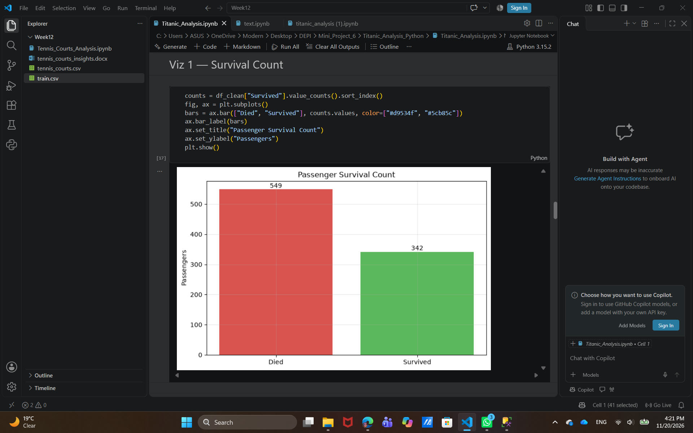
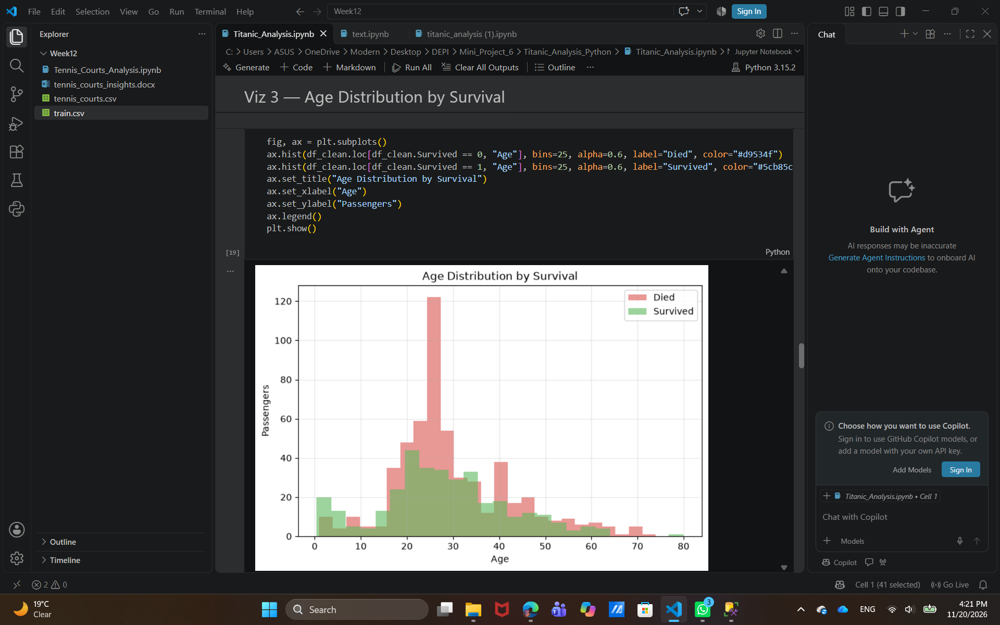
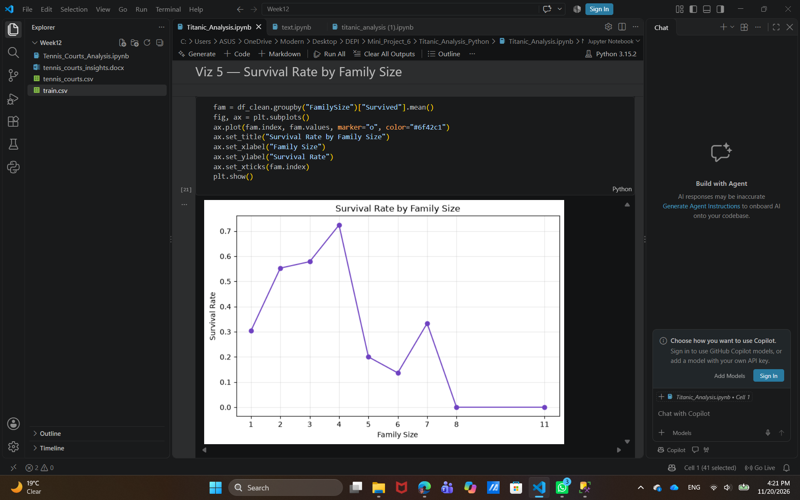
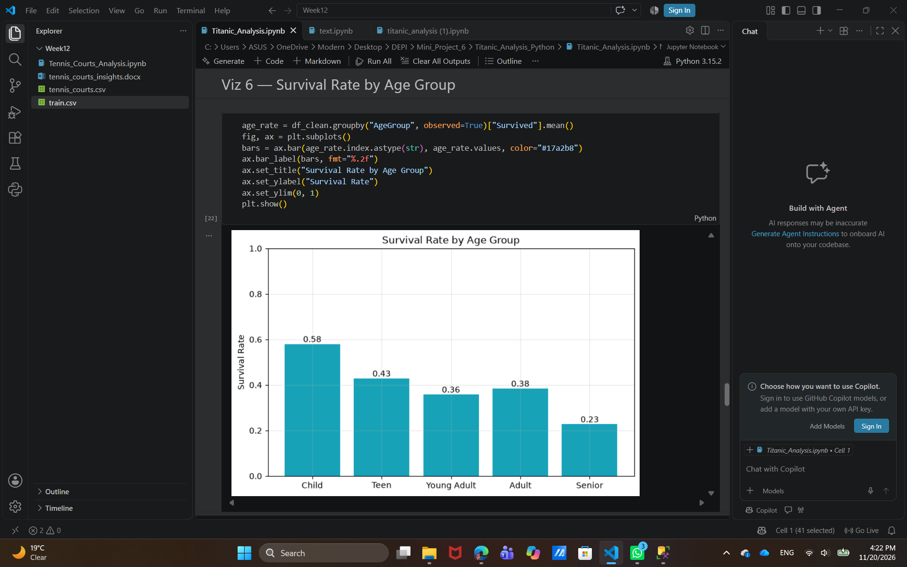
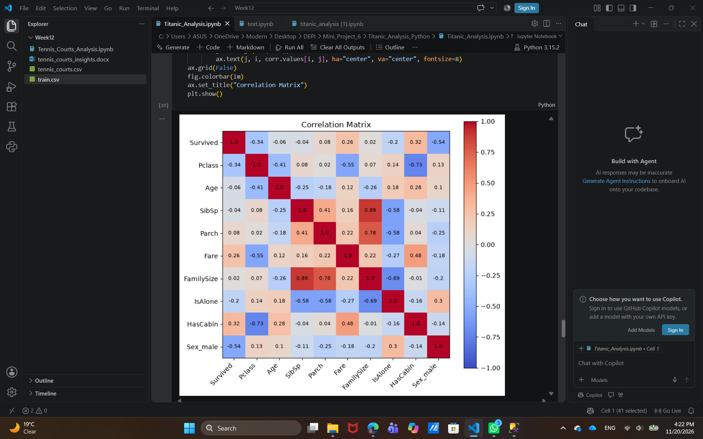
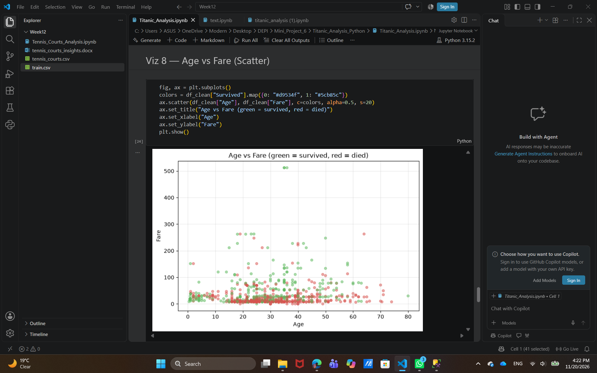

# 🚢 Titanic Data Analysis & Visualization Using Python

<p align="center">
  
</p>

<p align="center">
  <b>Exploratory Data Analysis | Data Cleaning | Feature Engineering | Data Visualization</b>
</p>

---

## 📌 Project Overview

This project focuses on performing **Exploratory Data Analysis (EDA)** on the Titanic dataset using Python.

The analysis explores passenger demographics, survival patterns, ticket fares, passenger classes, and family relationships to identify meaningful trends and factors associated with survival.

The project was completed as part of **Mini-Project 6 – Python Data Analysis & Visualization**.

## 🎯 Project Objectives

- Import and inspect the dataset using Pandas.
- Clean missing values and remove duplicate records.
- Perform Exploratory Data Analysis (EDA).
- Calculate descriptive statistics.
- Engineer new features to support deeper analysis.
- Analyze correlations between numerical variables.
- Detect potential outliers and anomalies.
- Create meaningful visualizations using Matplotlib.
- Generate analytical insights and recommendations.

## 🛠️ Tools & Technologies

| Tool | Purpose |
|---|---|
| Python | Data analysis and processing |
| Pandas | Data manipulation and cleaning |
| NumPy | Numerical operations |
| Matplotlib | Data visualization |
| Jupyter Notebook | Interactive analysis environment |

## 🔄 Data Preparation & Cleaning

The dataset was inspected and prepared through the following steps:

- Identifying missing values and calculating missing-value percentages.
- Checking and removing duplicate records.
- Handling missing `Age` values using median values grouped by passenger class and gender.
- Filling missing `Embarked` values using the mode.
- Extracting cabin-related information before removing the original `Cabin` column.
- Checking remaining missing values after cleaning.

## ⚙️ Feature Engineering

Several new features were created to support deeper analysis.

| Feature | Description |
|---|---|
| `FamilySize` | Total family members traveling together |
| `IsAlone` | Indicates whether a passenger was traveling alone |
| `Title` | Extracted passenger title from their name |
| `AgeGroup` | Groups passengers into age categories |
| `HasCabin` | Indicates whether cabin information was available |
| `Deck` | Extracted cabin deck information |

## 📊 Exploratory Data Analysis (EDA)

The analysis covered:

- Dataset structure and information.
- Missing-value analysis.
- Descriptive statistics.
- Categorical variable distributions.
- Survival rates across passenger groups.
- Pivot table analysis.
- Average age, fare, and family size comparisons.

## 📈 Data Visualizations

Eight visualizations were created using Matplotlib to explore survival patterns and relationships between passenger characteristics.

### 1. Passenger Survival Count

Compares the number of passengers who survived and those who did not.

<p align="center">
  
</p>

### 2. Survival Rate by Class and Sex

Examines survival differences across passenger classes and genders.

<p align="center">
  
</p>

### 3. Age Distribution by Survival

Compares age distributions between survivors and non-survivors.

<p align="center">
  
</p>

### 4. Fare Distribution by Passenger Class

Explores ticket fare variation across passenger classes and identifies potential outliers.

<p align="center">
  
</p>

### 5. Survival Rate by Family Size

Investigates the relationship between family size and survival probability.

<p align="center">
  
</p>

### 6. Survival Rate by Age Group

Compares survival rates across different age categories.

<p align="center">
  
</p>

### 7. Correlation Heatmap

Visualizes correlations between numerical variables to identify potential relationships.

<p align="center">
  
</p>

### 8. Age vs. Fare Scatter Plot

Explores the relationship between passenger age, ticket fare, and survival status.

<p align="center">
  
</p>

## 🔗 Correlation Analysis

A correlation matrix was generated to examine relationships between numerical features and survival.

The analysis highlighted:

- A negative relationship between passenger class and survival.
- A positive relationship between ticket fare and survival.
- A relationship between traveling alone and survival.
- The importance of examining gender alongside other passenger characteristics.

**Note:** Correlation indicates association, not causation.

## 💡 Key Analytical Insights

Based on the analysis, several important patterns were identified:

1. **Gender:** Female passengers had a substantially higher survival rate than male passengers.
2. **Passenger Class:** First-class passengers had the highest survival rate, followed by second and third class.
3. **Age:** Children showed higher survival rates than older passenger groups.
4. **Family Size:** Passengers traveling with family had a higher survival rate than passengers traveling alone.
5. **Fare:** Higher ticket fares were associated with higher survival rates.
6. **Cabin Information:** Passengers with recorded cabin information had higher survival rates, potentially reflecting differences in passenger class.
7. **Embarkation:** Survival rates varied across embarkation ports.

## 💡 Recommendations & Next Steps

- Consider gender, passenger class, age, fare, and family size as useful features for predictive modeling.
- Investigate missing cabin information and its potential effect on analysis.
- Apply appropriate outlier treatment or transformations to highly skewed fare values before modeling.
- Explore Logistic Regression and Decision Tree models as potential next steps.
- Interpret correlations carefully and avoid assuming that relationships imply causation.

## 📁 Repository Structure

```text
Titanic-Data-Analysis-Python/
│
├── Titanic_Data_Analysis.ipynb
├── titanic.csv
├── visualizations/
│   ├── survival_count.png
│   ├── survival_by_class_sex.png
│   ├── age_distribution.png
│   ├── fare_distribution.png
│   ├── survival_by_family_size.png
│   ├── survival_by_age_group.png
│   ├── correlation_heatmap.png
│   └── age_vs_fare.png
│
└── README.md
```

## 👩‍💻 Author

**Sara Raafat**

Business Information Systems Student | Aspiring Data Analyst

- [LinkedIn](https://www.linkedin.com/in/sarah-raafat-639a88259/)
- [GitHub](https://github.com/sararaafatmohamed-cmd)

---

<p align="center">
  <i>This project strengthened my practical skills in Python, data cleaning, exploratory data analysis, statistical analysis, feature engineering, and data visualization.</i>
</p>
